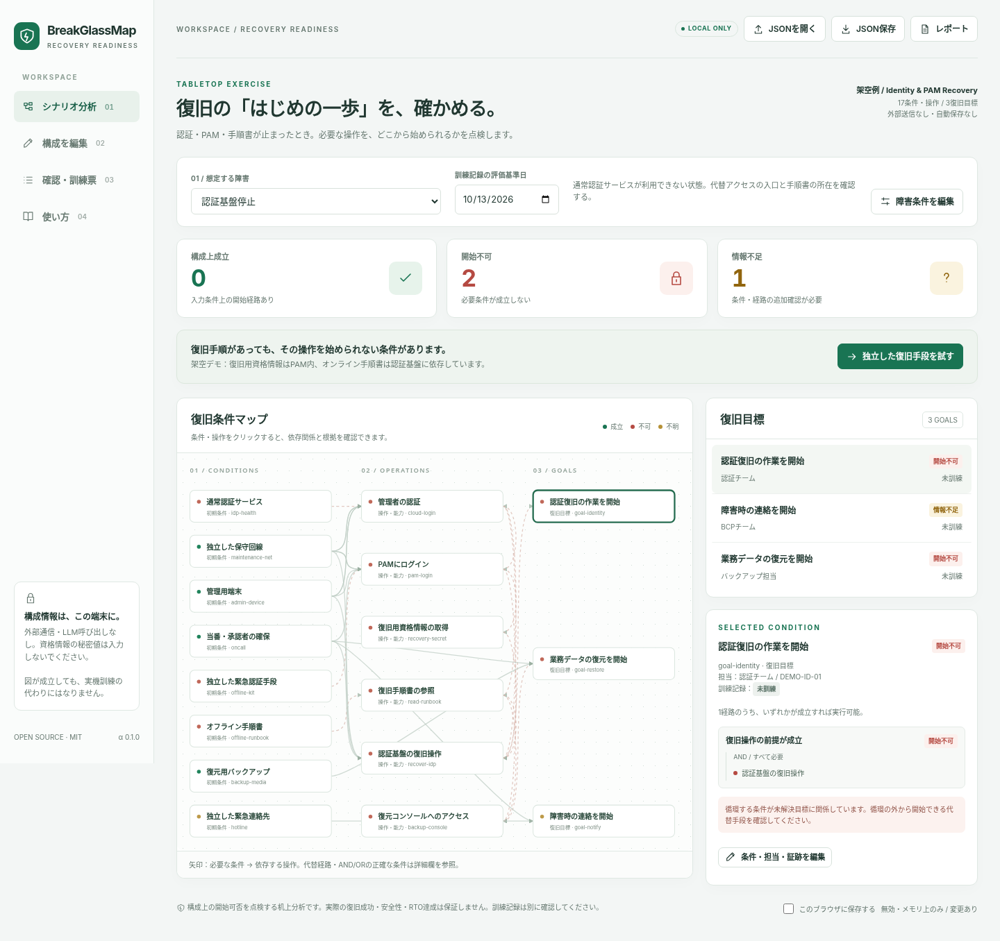

# BreakGlassMap

### Can you start recovery when identity is down?

Find the circular dependencies between identity, privileged access, recovery credentials and runbooks **before** an outage locks you out.

**Local-first · Single-file browser app · No LLM · No package dependencies · MIT**

[日本語ガイド](README.ja.md) · [Model reference](docs/MODEL.md) · [Security & limits](SECURITY.md) · [Verification](docs/VERIFICATION.md)



> **Alpha — v0.1.0-alpha.1.** A tabletop modeling aid, not a scanner, credential vault, recovery executor, compliance certification or proof that recovery will succeed.

## The problem

You have a backup. You have a runbook. You have an emergency account.

But the recovery credential is inside PAM, PAM requires the failed identity provider, and the runbook is behind the same login. The fallback switch may itself require the unavailable administrator session.

BreakGlassMap asks a narrower question than a full disaster-recovery platform: **which operations can actually be started under the conditions you modeled?**

## Try it without installing anything

Open **`dist/BreakGlassMap.html`** in a JavaScript-enabled browser. Everything needed is in that file: the application, engine, styles and fictional example. No CDN, fonts, API keys, telemetry or external requests.

The initial Japanese-language demo selects an identity-provider outage:

| Modeled result | Circular setup | Independent emergency access + offline runbook |
|---|---:|---:|
| Feasible under declared conditions | 0 | 2 |
| Cannot start | 2 | 0 |
| More information needed | 1 | 1 |

Click **「独立した復旧手段を試す」** to compare. The unknown hotline stays unknown; exercise records stay untested. This button changes only the local fictional model, not a real system.

Some managed browsers block local HTML. With Node.js 22 or newer installed, an alternative is:

```sh
npm start
```

Open the loopback URL printed by the command. The server exposes only the bundled HTML, binds to `127.0.0.1`, rejects hostile Host headers and does not accept model uploads. Respect your organization's browser policy; do not disable it to use this tool.

**Storage is off by default.** Export JSON before closing or reloading. Optional browser storage and exported files are **not encrypted**. Do not enter passwords, private keys, session cookies or tokens; topology and recovery access metadata can also be sensitive.

## What is included

- Resources, operations and recovery goals; named outage scenarios.
- Explicit **AND/OR** prerequisites, including nested expressions in JSON.
- Three-valued feasibility: **ready / blocked / unknown**.
- Circular-dependency explanations that do **not** reject independent escape paths.
- Form-based editing of conditions, alternative routes, scenarios, owners and SYSIDs.
- Separate exercise dates, reviewers, result, evidence references and scenario scope.
- Condition fingerprints: a changed model/scenario no longer presents the old bound exercise record as current.
- JSON import/export, dependency-map inspection, checklists, CSV and standalone HTML reports.
- CLI for deterministic analysis and CI gates; exactly the same engine as the UI.

No environment discovery, credential retrieval, network scanning or recovery execution is performed.

## CLI

No `npm install` is required. Run from the extracted repository:

```sh
node bin/breakglassmap.mjs validate examples/identity-outage.json
node bin/breakglassmap.mjs analyze examples/identity-outage.json --scenario identity-outage
```

The second command intentionally exits **2** because the demo contains blocked goals. For a report without a failing gate:

```sh
node bin/breakglassmap.mjs analyze examples/identity-outage.json --scenario identity-outage --as-of 2026-10-13 --format html --out report.html --fail-on none
node bin/breakglassmap.mjs analyze examples/independent-path.json --scenario identity-outage --format json --fail-on none
```

Existing output files are not overwritten unless you add `--force`.

| Exit | Meaning |
|---|---|
| 0 | No failure under the selected gate; **not** a recovery certification |
| 1 | Invalid input, usage or I/O error |
| 2 | At least one blocked recovery goal |
| 3 | No blocked goal, but at least one unknown goal |
| 4 | Feasible goals, but the strict evidence gate finds a non-current record |

`--fail-on none` disables outcome gates; `blocked` rejects only blocked goals; `unknown` (default) rejects blocked or unknown goals; `evidence` also requires **every modeled node** to have a current, scenario-matching, condition-bound self-reported record. `--as-of` defaults to UTC today. Run `--help` for the full contract.

The npm package is deliberately marked **private** to prevent accidental publication. Do not use an unverified `npx breakglassmap` package as a substitute for this repository.

## Why cycles alone are not enough

A cycle does not necessarily prevent recovery: an independent emergency method may provide the first usable entry point. Conversely, a cycle cannot manufacture its own starting credential.

The engine computes two **least fixed points** of a monotone AND/OR system: one using only declared available inputs, and one also allowing unknown inputs. A result is feasible in the lower bound, unknown if only the upper bound permits it, and blocked if neither permits it. Independent alternatives unlock cycles; unsupported self-dependencies remain blocked. A separate exhaustive Boolean oracle checks randomized small models.

A resource is an **independent initial condition**. Anything that depends on something else belongs in an operation/capability with routes. A forced outage is unavailable for the whole scenario; represent repair and post-repair capability explicitly, rather than expecting the engine to silently heal an unavailable input.

## Build and test

```sh
npm run build
npm test
```

Build/test/runtime require no third-party npm packages. Optional real-browser checks use a separately installed Python Playwright and local Chromium:

```sh
python tests/browser-smoke.py --browser /path/to/chromium
```

See [verification details](docs/VERIFICATION.md) for exactly what ran, including the managed-browser restriction in the build environment. CI configuration is supplied but has not been run on GitHub in this delivery.

## Initial-release boundaries

The analyzer accepts up to **250 nodes**, 16 routes per derived node, 8,000 reference occurrences, depth 12 and a 1 MiB model. The map previews up to 70 elements; all valid nodes are still analyzed and available in the table/reports. The UI is Japanese; the core result keys, CLI options and model format use English.

There is no resource consumption, exclusive action, time window, quorum threshold, credential expiry solver, recovery-time estimate, RTO optimization, SAT-minimal cut-set search or access-control verification. Conditions are assumed monotone; see [limitations](docs/LIMITATIONS.md).

The condition fingerprint detects accidental structural changes, **not tampering**. Evidence contents are not fetched or authenticated. No test suite proves your model is complete or your production recovery will work.

## Contributing and publication

See [CONTRIBUTING.md](CONTRIBUTING.md) and [release checklist](docs/RELEASE.md). Only fictional or fully sanitized models belong in public issues, pull requests and demos. No real customer configuration is included.

This source distribution has not created a GitHub repository or published a package. The name's registry/trademark availability has not been established. Review project naming, maintainer/security contact and the publication checklist before an external release.

Licensed under [MIT](LICENSE).
