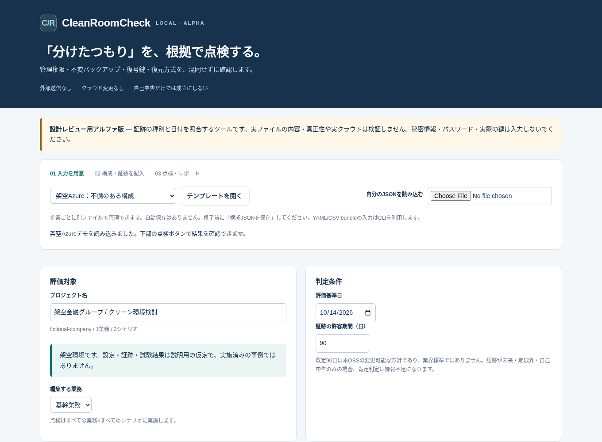

# CleanRoomCheck

**クラウドテナントが侵害されても、復旧環境は独立しているか。**

CleanRoomCheckは、本番・バックアップ・クリーン環境の構成を入力し、管理権限、通信経路、不変バックアップ、復号鍵、復元方式、検証手順を別々に点検するローカルOSSです。

**0.1.0a1 / アルファ版 / MIT / Python 3.10以上 / クラウド接続なし**

単なる「別テナントですか？」のチェックではなく、明示された管理権限グラフと、項目単位の証跡メタデータを使います。情報がない、証跡が古い、自己申告しかない場合は「情報不足」のまま残します。

> 本ツールは設計レビュー支援です。実クラウドや証跡の実ファイルを検証しません。成立表示は入力モデル上の条件充足であり、安全性、マルウェア不存在、復旧成功、コンプライアンス適合の認証ではありません。

## まず試す

ZIPを解凍し、このREADMEがあるディレクトリで実行します。JSON/CSV/HTML/CLI/Web UIは追加Pythonパッケージなしで動作します。

```bash
python -m cleanroomcheck demo --out demo-output
```

`demo-output/comparison.html` を開くと、不備のある架空Azure構成と、改善設計案の違いを確認できます。デモは固定日 **2026-10-14** で評価します。実施済みの構築・復元試験・顧客事例ではありません。

ブラウザから入力・点検する場合:

```bash
python -m cleanroomcheck serve --open-browser
```

Windowsでは `launch_windows.cmd`、macOSではターミナルから `python3 -m cleanroomcheck serve --open-browser` でも起動できます。`launch_macos.command` も同梱しています。

画面は `127.0.0.1:8765` で動作します。終了はターミナルでCtrl+C。入力は自動保存しないため、終了前に「構成JSONを保存」してください。ローカルUIを外部公開しないでください。



## 実装した機能

| 機能 | 初版の範囲 |
|---|---|
| 権限・分離境界 | 明示的な実効管理権限の多段経路。Azure全体管理者シナリオの同一テナント内サブスクリプション昇格を限定的に推論 |
| 通信経路 | 登録されたnetwork_reachエッジを評価。通信・依存・削除権限から管理権限を推論しない。管理権限だけで通信成立とも判定しない |
| バックアップ・鍵 | ロックモード/確定状態、復旧点への適用・期限、保持要件、復号鍵の管理/破壊権限、復号試験 |
| 復元方式 | 標準Azure VM復元の既知テナント制約、ワークロード不整合、製品対応確認の証跡不足。全製品・全サービスの対応表ではない |
| M365 | データ、ID/権限、設定、ドメイン/外部連携を別項目で整理 |
| 検証 | 隔離区画、検査記録、設定差分、権限、資格情報再発行、ログ、業務試験、再接続承認 |
| 説明用成果物 | 単体HTML、JSON、担当者/ベンダー質問票CSV、検証計画CSV、変更前後の比較 |
| 入力 | ブラウザフォーム＋高度なJSON編集、JSON、任意のYAML、CSV bundle |

ルールは **32件**、公式参照資料は **10件**。根拠資料は2026-10-14に確認した版で固定されており、自動更新しません。正確な対象・制約は `docs/RULES.md` と `docs/LIMITATIONS.md` を参照してください。

## 自社の環境に合わせる

```bash
# すべて未確認の入力を作る
python -m cleanroomcheck init --template blank --out company-a.json

# 型、ID、参照、上限の検証
python -m cleanroomcheck validate company-a.json

# 自社の入力で点検。出力先は新しいディレクトリを指定
python -m cleanroomcheck check company-a.json --out company-a-review --as-of 2026-10-14
```

`project.id`、資産、権限、想定侵害、業務、構成事実、証跡メタデータを会社ごとに変更します。A社とB社は別JSONで運用できます。共有サーバのマルチテナント管理や会社別アクセス制御を提供するものではありません。

登録するのは構成事実と証跡の参照情報です。**パスワード、トークン、秘密鍵、バックアップ本体を入れないでください。** JSONやレポートは暗号化されません。

### 証跡の考え方

各事実は `{"value": true, "evidence": ["cfg-01"]}` の形式です。証跡は別に登録します。

```json
{
  "id": "cfg-01",
  "type": "configuration",
  "collected_at": "2026-10-14",
  "reference": "承認済み構成確認票 rev3 / 管理権限の章"
}
```

`self_reported` / `configuration` / `tested` を区別します。肯定判定に必要な最低種別は項目ごとに異なります。複数条件をまとめて点検するルールでも、**各条件**に十分な証跡が必要です。証跡の実体・対象範囲・真正性は人が確認します。

既定の許容期間は90日。これは本OSSの変更可能な運用方針であり、規格や安全保証値ではありません。`--max-evidence-age-days` で変更できます。否定的な入力は証跡がなくても設計不備候補として出し、その根拠が弱いことを併記します。

### CSV / YAML

```bash
python -m cleanroomcheck csv-export company-a.json --out company-a-csv
# company-a-csv/facts.csv を編集する。ID/権限/証跡はstructure.json側
python -m cleanroomcheck check company-a-csv --out company-a-csv-review

# YAMLを利用するときだけ、ソースディレクトリから任意依存をインストール
python -m pip install ".[yaml]"
python -m cleanroomcheck check company-a.yaml --out company-a-yaml-review
```

CSV bundleは `structure.json` と `facts.csv` の2ファイルです。単一CSVから全構成を自動推測しません。`value_json` は `true` / `false` / `null` / 数値 / `"文字列"` のJSON値です。YAMLのアンカー・エイリアス・任意タグは対応外です。

## 比較と終了コード

```bash
python -m cleanroomcheck compare before.json after.json --out comparison-output --as-of 2026-10-14
```

同一プロジェクト・評価基準日・ルール・証跡期間で比較します。点検対象の削除、侵害条件の変更、FAILED→UNKNOWNを「解消」と数えません。プロバイダ/ワークロードの変更も評価範囲の変更として扱います。

`check` の既定終了コードは、**0=点検条件成立、1=不成立または情報不足あり、2=入力/出力エラー**。0も実環境の安全性を保証しません。資料作成を継続する目的では `--fail-on never`、不成立だけを終了1にする場合は `--fail-on failed` を使用できます。判定内容は変わりません。`demo` / `compare` の0は成果物生成成功を意味します。

## 架空デモ

Azure例は1業務・3侵害シナリオ・32ルールの **96点検** です。同じ設計問題が複数シナリオに現れるため、独立した脆弱性の件数ではありません。

| 判定 | 不備のある構成 | 改善設計案 |
|---|---:|---:|
| 不成立 | 35 | 0 |
| 情報不足 | 36 | 39 |
| 成立（モデル上） | 13 | 45 |
| 対象外 | 12 | 12 |

改善案は、別テナント化などの設計変更を仮定しただけです。製品は未選定であり、対応性が確認待ちになった分、情報不足が3点検増えます。復号・復元・検証試験は実施済みとしていません。

## ドキュメント

- `docs/QUICKSTART_JA.md`: 操作と初回ヒアリング
- `docs/MODEL.md` / `docs/model.schema.json`: 入力モデルと型
- `docs/RULES.md`: ルールと証跡条件
- `docs/REFERENCE_PATTERNS.md`: 出典付きの構成パターン
- `docs/LIMITATIONS.md`: 判定限界・未実装・既知の運用上の注意
- `docs/DEMO_REPORT_JA.md`: デモの仮定・指摘・改善案
- `docs/VERIFICATION.md`: 今回実施した確認と未実施事項
- `docs/PUBLISH.md`: GitHub公開前の手順

## 開発

```bash
python -m unittest discover -v
```

YAMLのテストはPyYAMLがないとスキップされます。任意のブラウザ試験は `tools/browser_smoke.py`、ブラウザの外部ナビゲーションを使わないコンポーネント試験は `tools/browser_component_smoke.py` です。後者はHTTP通し試験の代替認定ではありません。

32ルールの根拠と判定条件を変える際は、肯定・否定・未確認の再現テストを追加してください。出典更新だけで実クラウドの対応を確認したことにはしないでください。

**実装していないもの:** クラウドAPI収集、デプロイ/復元実行、マルウェア検出、全製品の対応性評価、IAM/SCP条件の完全解析、証跡ファイルの真正性確認、BreakGlassMap互換アダプター。名称の商標/既存プロジェクトとの重複調査も未実施です。
